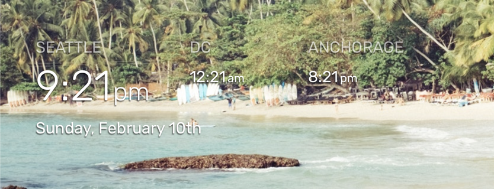
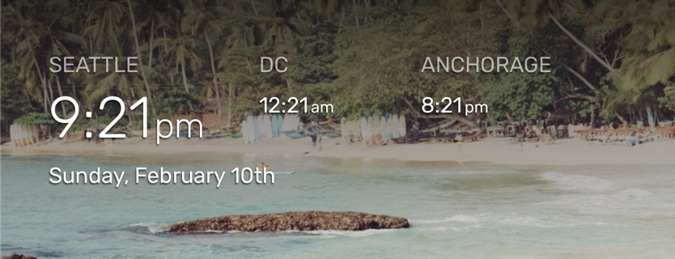
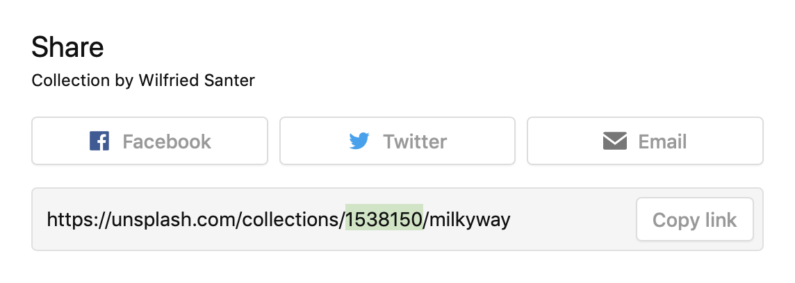

# WallberryTheme: A MagicMirror² Module
The `WallberryTheme` module re-themes [MagicMirror²](https://github.com/MagicMirrorOrg/MagicMirror) to look like a beautiful photo-box wall display. It adds a new font, styles, and periodically changing background image pulled from Unsplash.com.

The WallberryTheme also comes packaged with two companion modules for displaying the time (`WB-clock`) and weather (`WB-weather`).

## Modules in this repository

| Module | Shows | Documentation |
|--------|-------|---------------|
| `WallberryTheme` | The background photo from Unsplash, with fades and auto-dim for readable text | [Configuration options](#configuration-options) below |
| `WB-clock` | The local time and date, optionally the time in other cities | [WB-clock's README](WB-clock/README.md) |
| `WB-weather` | The current weather and a forecast of several days | [WB-weather's README](WB-weather/README.md) |

One clone installs all three; [Installation](#installation) and [Updating](#updating) below apply to each of them.

## About this fork

This is a fork of [delightedCrow/WallberryTheme](https://github.com/delightedCrow/WallberryTheme), created by Jess Coulter. It is an independent continuation: Jess Coulter is not involved in it. The original is no longer updated: its last release, 3.1.0, came out in 2021, and its weather module has stopped working since, as Apple shut down Dark Sky's API and OpenWeatherMap shut down One Call 2.5. This fork keeps the theme running on current MagicMirror² installations: it brings back the weather, with a provider that needs no API key, and fixes the bugs it finds along the way.

Fixes and updates come on a best-effort basis, without fixed release dates. Please report bugs and suggest features in this repository's [issues](https://github.com/raywo/WallberryTheme/issues), not in the original's.

Already running the original? See [Switching from the original](#switching-from-the-original).

## Screenshots
<p align="center">


</p>

## Features

- **A new photo every few minutes:** WallberryTheme shows a random photo from Unsplash as the mirror's background, optionally from your own collections or matching your search queries.
- **Readable on bright photos:** soft fades behind the top and bottom bar regions and an automatic dimming of bright photos keep white text legible (see below).
- **WB-clock** shows the local time and date and, optionally, the time in other cities. See [WB-clock's README](WB-clock/README.md).
- **WB-weather** shows the current weather and a forecast of several days, from [Open-Meteo](https://open-meteo.com/), which needs no API key, or from [OpenWeatherMap](https://openweathermap.org/). You choose how it looks with display templates, and further weather providers can be added by subclassing its `WBProvider` class. See [WB-weather's README](WB-weather/README.md).
- **English and German:** the texts of WallberryTheme and WB-weather follow the `language` of your MagicMirror config.

### Options for bright images

- The `addBackgroundFade` option allows you to add soft gradient backgrounds to the top and bottom regions of your magic mirror, providing more contrast for the modules in those regions. These gradients use Unsplash's color data to automatically shift to the general color hue of the photo, so they blend better with the image. A browser without CSS relative colour syntax (older than Chromium 119, Firefox 128 or Safari 18), which can only show the mirror in server-only mode, shows neutral dark gradients instead.

- The `autoDimOn` feature checks how well white text reads in the areas behind the top bar and bottom bar regions, measured on the photo as it looks under the background fades, and dims the photo when the contrast is too low for body text. Photos that are bright only where no text sits, or dominated by deep, saturated colours, stay vibrant.

**No background fade, auto dim set to off:**


**With addBackgroundFade and autoDimOn (on their default settings):**


## Differences from the original

Compared with the original's last release, 3.1.0, this fork changes the following. The [Changelog](CHANGELOG.md) lists every change.

**Weather (WB-weather)**

- **Open-Meteo, without an API key:** the new provider `"openmeteo"` needs only your latitude and longitude. It shows day and night icons and describes the weather in words, e.g. "Partly cloudy", in English or German.
- **`providerName` is required:** WB-weather no longer falls back to a provider; a config without `providerName` shows an error instead of the weather.
- **Dark Sky is gone:** Apple shut down Dark Sky's API in 2023. A config with `providerName: "darksky"` or `darkSkyApiKey` shows an error instead of the weather.
- **OpenWeatherMap uses One Call 3.0:** One Call 2.5, which the original calls, has been shut down. Your OpenWeatherMap key needs the "One Call by Call" subscription, which is free up to 1,000 calls per day but requires a payment method.
- The `classic-wallberry` template shows the forecast in one row next to the current weather.
- The forecast names the weekdays in your `language` also without WB-clock, and OpenWeatherMap describes the weather in your `language`.

**Background (WallberryTheme)**

- `autoDimOn` dims a photo when white text would be hard to read behind the top or bottom bar, instead of counting light pixels over the whole photo.
- The tints of the background and the fades look equally dark whatever the photo's colour.
- The photo loads also when Electron is not installed, and the theme keeps changing photos after Unsplash answers with an error, e.g. when the rate limit is exceeded.
- The photo attribution, the loading message and the error messages are available in German.
- Other modules can ask for a new photo, optionally with their own search queries or collections, with the notification [`WALLBERRY_FETCH_PHOTO`](#changing-the-photo-from-another-module).

**Clock and font**

- WB-clock shows the date in the word order of your `language`, e.g. "Montag, 26. Oktober" for German.
- The Rubik font covers characters beyond basic Latin, such as in "Łódź" or "Plzeň".

## Required API keys

- A (free) Unsplash API key is required and can be obtained from [Unsplash.com](https://unsplash.com/developers).

WB-weather needs no API key with its Open-Meteo provider. If you prefer OpenWeatherMap, see [WB-weather's weather providers](WB-weather/README.md#available-weather-providers) for the key it needs.

## Installation

To use this module and its companion modules:
1.  Clone this repository into your `MagicMirror/modules` directory:
    ```bash
    cd ~/MagicMirror/modules
    git clone https://github.com/raywo/WallberryTheme.git
    ```
2.  Add the modules to the `modules` array in your `config/config.js` file, as the example under [Configuration](#configuration) shows.

## Updating

To update to the latest version, pull it into your clone and restart MagicMirror:

```bash
cd ~/MagicMirror/modules/WallberryTheme
git pull
```

Before you update, check the [Changelog](CHANGELOG.md) for changes marked **Breaking**: they need a change to your config. The [releases](https://github.com/raywo/WallberryTheme/releases) list the same changes for each version.

## Switching from the original

If you installed the original from delightedCrow/WallberryTheme, you switch to this fork in your existing clone; your config stays where it is.

1.  Point your clone at this fork and check out its `main` branch – the original's branch is called `master`:
    ```bash
    cd ~/MagicMirror/modules/WallberryTheme
    git remote set-url origin https://github.com/raywo/WallberryTheme.git
    git fetch origin
    git checkout -B main origin/main
    ```
    From then on, `git pull` updates from this fork.
2.  Change your WB-weather config in `config/config.js`:
    - Add `providerName`, which is required now. For a weather without an API key, use `providerName: "openmeteo"` with your `latitude` and `longitude`, and remove `apiKey`.
    - If you used Dark Sky, remove `providerName: "darksky"` and `darkSkyApiKey` and use `providerName: "openmeteo"`.
    - If you keep OpenWeatherMap, set `providerName: "openweathermap"` and add the "One Call by Call" subscription to your key.

    [WB-weather's README](WB-weather/README.md#upgrading-from-an-earlier-version) explains each case.
3.  If your WB-clock config has `OtherCities`, rename it to `otherCities`: the original's WB-clock README named it with a capital O, which WB-clock ignores.
4.  Restart MagicMirror.

## Configuration

The following example configures all three modules; WB-clock and WB-weather are optional. Paste it into the `modules` array of your `config/config.js`:

```javascript
// Base WallberryTheme adds new font, styles, and a rotating background image pulled from Unsplash.com
{
  module: "WallberryTheme",
  position: "fullscreen_below", // Required Position
  config: {
    unsplashAccessKey: "Your Unsplash API Key", // REQUIRED
    collections: "2589108" // optional - leave empty for a random photo
  }
},
// WB-clock adds local time (Optional Module)
{
  module: "WallberryTheme/WB-clock",
  position: "top_bar", // highly suggest using top_bar position
  config: {
    localCityName: "Seattle", // optional
    otherCities: [
      {name: "DC", timezone: "US/Eastern"}, // optional
      {name: "Anchorage", timezone: "US/Alaska"} // optional
    ]
  }
},
// WB-weather adds weather (Optional Module)
{
  module: "WallberryTheme/WB-weather",
  position: "bottom_bar",  // Highly suggested location
  config: {
    // See "Configuration options" for more information.
    providerName: "openmeteo", // REQUIRED
    latitude:   47.603230, // REQUIRED
    longitude: -122.330276 // REQUIRED
  }
},
```

### Configuration options

The following properties of `WallberryTheme` can be configured. For more information on how to configure the [WB-clock](WB-clock/README.md) and [WB-weather](WB-weather/README.md) modules see their individual README files.


| Option                      | Type    | Description
| ----------------------------|---------| ----------------
| `unsplashAccessKey`         | String  | Your Unsplash API access key. Sign up for free at [https://unsplash.com/developers](https://unsplash.com/developers). Demo accounts are allowed `50 API requests per hour`. <br><br>  This value is **REQUIRED**
| `collections`               | String  | A comma-separated list of Unsplash collection IDs that photos should be pulled from. Collection IDs can be found in the URL of the collection, shown in the highlighted part of this screenshot:   <br><br> **Example:** `"1538150,162213"` <br> **Default value:** `""` (no collection, theme will use a random Unsplash photo)
| `queries`                   | Array   | A list of queries to search for on Unsplash. When multiple queries are specified, one gets randomly picked every refresh. <br><br> **Example:** `["cars", "new york", "black cat"]` <br> **Default value:** `[]`
| `updateInterval`            | Number  | How often the photo should change (Milliseconds). Each change costs an Unsplash request: below `72000` (72 seconds) a demo key runs out of requests within the hour, see [Unsplash's rate limit](#unsplashs-rate-limit). <br><br> **Default value:** `300000` (5 minutes)
| `newPhotoOnResume`          | Boolean | Whether WallberryTheme shows a new photo when it is shown again after being hidden, e.g. by a page module such as MMM-pages or by a presence sensor. With `false` it keeps the photo it showed before, which saves Unsplash requests on mirrors that hide and show modules often; the photo then changes once `updateInterval` has passed since the last change, counting the time it was hidden. With `true` every switch fetches a new photo and costs a request, see [Unsplash's rate limit](#unsplashs-rate-limit). <br><br> **Possible values:** `true` (new photo) or `false` (keep the photo) <br>**Default value:** `false`
| `orientation`               | String  | What screen orientation photos should be optimized for. <br><br> **Possible values:** `"portrait"`, `"landscape"`, or `"squarish"` <br> **Default value:** `"portrait"`
| `backgroundOpacity`         | Number  | Controls the darkness of the background photo. <br><br> **Possible values:** Any number from `0.0` (black screen) to `1` (fully bright image)<br> **E.G.**: `0.5` would be the background at half brightness<br> **Default value:** `1`
| `brightImageOpacity`        | Number  | Controls the darkness of photos that `autoDimOn` dims. Only used when `autoDimOn` is `true`. <br><br> **Possible values:** Any number from `0.0` (black screen) to `1` (fully bright image)<br> **Default value:** `0.85`
| `autoDimOn`                 | Boolean | Darkens a photo to the value set by `brightImageOpacity` when white text would be hard to read behind the top bar or bottom bar region. The check measures the photo as it looks under the fades of `addBackgroundFade`, or the photo alone without them, and dims when the [APCA](https://readtech.org/ARC/) contrast of white text against the brightest tenth of either area falls below Lc 75, the minimum for body text. <br><br> **Possible values:** `true` (on) or `false` (off) <br>**Default value:** `true`
| `addBackgroundFade`         | Array   | Adds darker gradient backgrounds to the top bar region and/or bottom bar regions of MagicMirror (helps with readability for bright or busy background images). <br><br> **Possible values:** `"top"` will add a gradient background to the top bar region, `"bottom"` will add a gradient background to the bottom bar region. Set to an empty list to remove all gradients.  <br>**Default value:** `["top", "bottom"]`
| `clearCacheOnStart`         | Boolean | Clears Electron's cache on MagicMirror startup, preventing an issue where Electron would sometimes encounter a CORS error when trying to load a previously cached background image ([see this issue here for details](https://github.com/delightedCrow/WallberryTheme/issues/8)). Has no effect when MagicMirror runs without Electron, e.g. in server-only mode or when Electron is not installed.  <br><br> **Possible values:** `true` (on) or `false` (off) <br>**Default value:** `true`
| `imageHeight`               | String or Number  | Use "auto" to use your screen's height, or specify a hardcoded width in pixels. <br><br> **Default value:** `"auto"`
| `imageWidth`                | String or Number  | Use "auto" to use your screen's width, or specify a hardcoded width in pixels. <br><br> **Default value:** `"auto"`
| `imageOptions`              | String  | See [Unsplash documentation](https://unsplash.com/documentation#dynamically-resizable-images) for supported parameters. <br><br> **Default value:** `"fit=crop"`

### Unsplash's rate limit

A demo access key allows 50 requests per hour; once Unsplash approves your application for production, the key allows 1,000. Every new photo costs one request, wherever the change comes from:

- the start of MagicMirror,
- every `updateInterval`,
- every time the module is shown again, with `newPhotoOnResume: true`,
- every [`WALLBERRY_FETCH_PHOTO`](#changing-the-photo-from-another-module) notification, e.g. on each page change.

The changes add up within the hour. A photo every 5 minutes uses 12 requests per hour; a mirror that also asks for a new photo on each page change and switches pages every minute needs 60 more and runs out of a demo key's requests within the hour.

Once the limit is exceeded, the photo on screen stays and stops changing until the hour is over; WallberryTheme tries again after each `updateInterval`. Only without a photo, e.g. right after the start, it shows the message that the rate limit is exceeded. Mirrors that share an access key share its limit.

### Changing the photo from another module

Other modules can ask WallberryTheme for a new photo with the notification `WALLBERRY_FETCH_PHOTO`, e.g. to show a photo that fits the page of a mirror with several pages. WallberryTheme fetches and shows a new photo right away, and changes it again a full `updateInterval` later. If WallberryTheme is hidden when the notification arrives, it fetches the photo once it is shown again.

The payload is optional and chooses the photo for this one fetch:

| Payload key   | Type            | Description
| --------------|-----------------| ----------------
| `queries`     | Array or String | Search queries, one of which is picked at random, like the `queries` option. <br><br> **Example:** `["football", "stadium"]`
| `collections` | String          | A comma-separated list of Unsplash collection IDs, like the `collections` option. <br><br> **Example:** `"1538150,162213"`

A payload with `queries` or `collections` replaces both options for this fetch, so configured collections do not narrow a page's search; a key it leaves out is empty. Without a payload, or with neither key, the configured `queries` and `collections` apply. The fetch after `updateInterval` uses the configured values again.

Every notification costs an Unsplash request, on top of the photo changes of `updateInterval`. A demo key allows 50 requests per hour: a mirror that switches pages every minute and asks for a photo on each switch runs out of requests within the hour, and its photo then stops changing. See [Unsplash's rate limit](#unsplashs-rate-limit).

[MMM-pages](https://github.com/edward-shen/MMM-pages) does not send this notification itself, but announces each page change with `NEW_PAGE` and the page's index. [MMM-NotificationTrigger](https://github.com/MMRIZE/MMM-NotificationTrigger) can turn that into a photo request; this config shows sports photos on the second page and the configured photos on all others:

```javascript
{
  module: "MMM-NotificationTrigger",
  config: {
    triggers: [
      {
        trigger: "NEW_PAGE",
        fires: [
          {
            fire: "WALLBERRY_FETCH_PHOTO",
            payload: (page) => (page === 1 ? {queries: ["football", "stadium"]} : null)
          }
        ]
      }
    ]
  }
},
```

MMM-pages also sends `NEW_PAGE` when it starts. If that arrives after WallberryTheme's first photo request, this config fetches a second photo at startup, which costs one more request.

## Text on coloured backgrounds

WallberryTheme gives all text on the mirror a dark shadow (`text-shadow: -1px 2px 2px rgba(0, 0, 0, 0.6)` on `body`), so that white text stays legible on the photo. A text shadow is inherited, so it reaches the text of every other module as well. Text that sits on a coloured background of its own, such as a badge or a line number, does not need the shadow and shows it as a dark, smeared edge – most visibly on light colours.

The theme cannot tell which text sits on its own background, so you switch the shadow off for these elements yourself. Add a rule to `MagicMirror/css/custom.css` that sets `text-shadow: none` on the element. For the line numbers of [MMM-PublicTransportHub](https://github.com/KristjanESPERANTO/MMM-PublicTransportHub):

```css
.mmm-pthub-line-sign {
  text-shadow: none;
}
```

Text elsewhere on the mirror keeps its shadow. For another module, use the class of the element that has the coloured background. To find it, open the developer tools of MagicMirror's window or browser and inspect the element. If the class is a generic one that other modules may use too, put the module's name in front of it – MagicMirror gives each module's wrapper the module's name as a class:

```css
.MMM-SomeModule .badge {
  text-shadow: none;
}
```

## Contributing

Contributions of all kinds (pull requests, bug reports, feature suggestions, documentation, etc.) are welcome and encouraged. Please report bugs and suggest features in this repository's [issues](https://github.com/raywo/WallberryTheme/issues).

If you're enjoying the WallberryTheme:

* **:coffee: [Buy me a coffee](https://buymeacoffee.com/raywo) :coffee:** if the fixes in this fork are useful to you.
* Thank Jess Coulter, who created the WallberryTheme, with a [coffee on Ko-fi](https://ko-fi.com/delightedcrow).

Huge thanks to everyone who has contributed and made the WallberryTheme better!

### Guidelines for Pull Requests
- **Pull Requests should be submitted to the `main` branch**
- If there isn't one already, it's helpful to open an issue detailing the feature/bug your PR will address before you submit it.
- Add a short description of your change to the [Changelog file](CHANGELOG.md) file under the `[Unreleased]` section.

## Attributions & Special Thanks

- [Jess Coulter (delightedCrow)](https://github.com/delightedCrow) created the WallberryTheme and its companion modules and maintained them up to version 3.1.0. Thank you for this beautiful theme <3
- Thanks to the magnificent MagicMirror² community, y'all are creative and awesome <3
- The APCA contrast formula in [colorHelpers.js](colorHelpers.js) is adapted from `contrastAPCA` of [chroma.js](https://github.com/gka/chroma.js) by Gregor Aisch (BSD licence, notice in the file), which implements the [APCA](https://github.com/Myndex/apca-w3) contrast prediction by Myndex.

## License

WallberryTheme is released under the [MIT License](LICENSE).

- Copyright (c) 2018 Jess Coulter, for the original WallberryTheme
- Copyright (c) 2026 Ray Wojciechowski, for the changes in this fork

## Changelog

Visit the [Changelog file](CHANGELOG.md) to see the latest changes to the project :)
