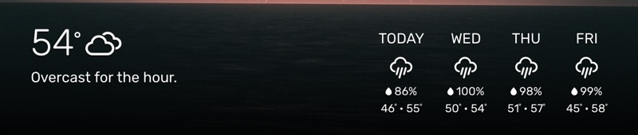

# Module: WB-weather
Part of [WallberryTheme](../README.md), which describes the [installation](../README.md#installation) and [updating](../README.md#updating) of all three modules.

The `WB-weather` module was designed to complement the `WallberryTheme` module and displays the current weather and forecast. It gets the weather from the provider you choose with `providerName`: [Open-Meteo](https://open-meteo.com/), which needs no API key, or [OpenWeatherMap](https://openweathermap.org/).

## Using the module

To use this module, add it to the modules array in the `config/config.js` file:
````javascript
{
	module: "WallberryTheme/WB-weather",
	position: "bottom_bar",  // Highly suggested location
	config: {
		// See "Configuration options" for more information.
		providerName: "openmeteo",
		latitude:   47.603230,
		longitude: -122.330276
	}
},
````

Without `providerName`, WB-weather shows an error naming the possible values instead of the weather.

### Upgrading from an earlier version

 * **Your config has no `providerName`:** add `providerName: "openweathermap"` to keep OpenWeatherMap, which needs a new subscription (see the last point), or replace your `apiKey` with `providerName: "openmeteo"` to use Open-Meteo without a key.
 * **You used Dark Sky** (`providerName: "darksky"` or `darkSkyApiKey`): Apple has shut down Dark Sky's API, and WB-weather no longer supports it. Replace both with `providerName: "openmeteo"`; Open-Meteo needs no key.
 * **You used OpenWeatherMap before One Call 3.0:** WB-weather no longer calls the shut-down One Call 2.5, and your key needs the "One Call by Call" subscription for One Call 3.0 (see [OpenWeatherMap](#openweathermap) below). Without it, WB-weather shows OpenWeatherMap's error message instead of the weather. Subscribe, or set `providerName: "openmeteo"` and remove your `apiKey`.

## General Configuration Options

These general options should honored the same across all weather providers. Specific weather providers may provide further options.

| Option                      | Default            | Type       | Description
| ----------------------------|--------------------| -----------|------------
| `providerName` <br>**REQUIRED** | None           |String      | The name of your weather provider. <br><br> **Possible values:** `"openmeteo"`, `"openweathermap"` (See available weather providers below).
| `latitude` <br>**REQUIRED** | None               |Number      | Your current latitude.
| `longitude` <br>**REQUIRED**| None               |Number      | Your current longitude.
| `apiKey`                    | None               |String      | The API key for your weather provider, if it needs one. Open-Meteo needs none; OpenWeatherMap requires one.
| template                    | "classic-wallberry"|String      | The name of your weather template. (See available templates below).
| `units`                     | config.units       |String      | What temperature units to use. **Possible values:** `"imperial"`, `"metric"`, `"standard"`<br>
| `language`                  | config.language    |String      | The language OpenWeatherMap describes the weather in. <br><br> **Possible values:** `en`, `nl`, `ru`, etc...<br><br> WB-weather's own texts, the weekdays of the forecast and Open-Meteo's description follow the `language` of your MagicMirror config instead; WB-weather's own texts are in English and German.<br>
| `daysToForecast`            | 4                  |Number      | How many days to forecast in weekly forecast. <br><br> **Possible values:** Varies by provider. With the `classic-wallberry` template on a 1080 px wide portrait screen, up to 5 days fit in one row next to the current weather. <br>
| `updateInterval`            | The provider's minimum|Number   | How often to fetch new weather data (Milliseconds). Limits vary by provider: 15 minutes for Open-Meteo, 10 minutes for OpenWeatherMap.

-------------------------------

## Available Weather Providers

### Open-Meteo

[Open-Meteo](https://open-meteo.com/) is free for non-commercial use and needs no API key.

 * **No API key and no sign-up.** Set `providerName: "openmeteo"` with your `latitude` and `longitude`.
 * **Units:** `units: "imperial"` shows Fahrenheit; any other value, including `"metric"`, `"standard"` and none, shows Celsius. Open-Meteo offers no Kelvin.
 * **Icons:** the current weather shows a day or night icon, depending on whether the sun is up at your location; forecast days show the day icon. A forecast day with snowfall or snow in its weather shows the snowflake next to its chance of precipitation, any other day the raindrop.
 * **Description:** Open-Meteo sends no text, so WB-weather describes the current weather itself, e.g. “Partly cloudy”, in the `language` of your MagicMirror config: English or German, any other language shows English.
 * If Open-Meteo rejects the request, e.g. for a latitude out of range, WB-weather shows Open-Meteo's reason instead of the weather and does not try again. After a network error, or once Open-Meteo's request limit is reached, it tries again after 15 minutes.
 * **Minimum limit for updateInterval:** 15 minutes, as Open-Meteo does not update its weather data faster than that.
 * **Maximum number of forecast days:** 16 days.

#### Open-Meteo Configuration Options

| Option                      | Default            | Type       | Description
| ----------------------------|--------------------| -----------|------------
| `providerName` <br>**REQUIRED** | None           |String      | `"openmeteo"`
| `latitude` <br>**REQUIRED** | None               |Number      | Your current latitude.
| `longitude` <br>**REQUIRED**| None               |Number      | Your current longitude.

#### Sample WB-weather config Using Open-Meteo

````javascript
{
	module: "WallberryTheme/WB-weather",
	position: "bottom_bar",  // Highly suggested location
	config: {
		providerName: "openmeteo",
		latitude:   47.603230,
		longitude: -122.330276
	}
},
````

### OpenWeatherMap

 * **Sign up for an API key at [https://openweathermap.org/api](https://openweathermap.org/api)**.
 * **Your key needs the "One Call by Call" subscription.** WB-weather uses the [One Call API 3.0](https://openweathermap.org/api/one-call-3), which OpenWeatherMap offers only as this separate subscription, even with a free account. Subscribe on [https://openweathermap.org/api/one-call-3](https://openweathermap.org/api/one-call-3).
 * The subscription is free up to 1,000 API calls per day, but OpenWeatherMap requires a payment method to subscribe. Calls beyond 1,000 per day are charged; set a daily call limit in your OpenWeatherMap account to prevent that. With the default `updateInterval` of 10 minutes, WB-weather makes 144 calls per day.
 * Without the subscription, WB-weather shows OpenWeatherMap's error message instead of the weather and does not try again.
 * **Minimum limit for updateInterval:** 10 minutes ([OpenWeatherMap suggests a limit](https://openweathermap.org/appid) of 1 API call every 10 minutes because their weather servers do not update weather any faster than that.)
 * **Maximum number of forecast days:** 8 days.

#### OpenWeatherMap Configuration Options

| Option                      | Default            | Type       | Description
| ----------------------------|--------------------| -----------|------------
| `providerName` <br>**REQUIRED** | None           |String      | `"openweathermap"`
| `apiKey` <br>**REQUIRED**   | None               |String      | Your OpenWeatherMap API Key.
| `latitude` <br>**REQUIRED** | None               |Number      | Your current latitude.
| `longitude` <br>**REQUIRED**| None               |Number      | Your current longitude.

#### Sample WB-weather config Using OpenWeatherMap

````javascript
{
	module: "WallberryTheme/WB-weather",
	position: "bottom_bar",  // Highly suggested location
	config: {
		// See "Configuration options" for more information.
		apiKey: "add your OpenWeatherMap API KEY here",
		providerName: "openweathermap",
		latitude:   47.603230,
		longitude: -122.330276
	}
},
````
-------------------------------

## Available Display Templates

### Classic Wallberry

The current default template for WB-weather. Displays the current weather and upcoming forecast.

* **Template Name:** `"classic-wallberry"`
* **Providers Supported:** Open-Meteo, OpenWeatherMap

Sample Screenshot:



-------------------------------

# WB-weather Development

**Pull Requests for adding new providers and templates to WB-weather are very welcome!**

**BEFORE** you submit your pull request:

- Please read [The Contributing Section of the WallberryTheme README](../README.md#Contributing).
- **If you add a Template**: include a section for your template under the  `Available Display Templates` header in this README with the appropriate documentation (see the classic-wallberry template above for an example). **Make sure you include a sample screenshot of your template**, saved in `WB-weather/images/`.
- **If you add a Weather Provider**: include a section for your provider under the `Available Weather Providers` header in this README with appropriate documentation (see the openweathermap provider for above for an example).

-------------------------------

## Writing A New Weather Provider

All weather providers are located in the `WB-weather/providers/` directory and should subclass the [`WBProvider` class](WB-provider.js).

### Examples

* [WB-openweathermap.js](providers/WB-openweathermap.js) subclasses `WBProvider` and implements the OpenWeatherMap API.
* [WB-openmeteo.js](providers/WB-openmeteo.js) subclasses `WBProvider` and implements the Open-Meteo API, which needs no API key.

### Provider Naming Conventions

- Choose a short name for your provider, such as `myprovider`, that users will use in the `providerName` option in their module config file.
- **Make sure your providerName is LOWER CASE.**
- Name your provider's javascript file `WB-{myprovider}.js`, with `{myprovider}` being your `providerName`.
- Add your `providerName` to `providerNames` in [WB-weather.js](WB-weather.js); the error for a config without `providerName` lists these names as the possible values.

### Implementing WBProvider

Subclassing `WBProvider` is the simplest way to add a new weather provider.

* **Don't forget** to register your provider class with `WBProviderManager` at the end of your file!


````javascript
class WBMyProvider extends WBProvider {
	constructor(config, delegate) {
		super(config, delegate);
		// your init here
	}

	get updateIntervalLimit() {
		// implement
	}

	get daysToForecastLimit() {
		// implement
	}

	fetchWeather() {
		// implement
	}

// VERY IMPORTANT, WB-weather won't find you otherwise!
WBProviderManager.register("myprovider", WBMyProvider);

````

### Configuration Options

The configuration options chosen by the user will be passed to your constructor via the `config` variable.

* Your provider should support all of the general options listed in the `General Configuration Options` section at the top of this README.
* You are welcome to add more config options specific to your provider (just make sure you document them for your users!).

### Required Functions

For your provider to work, `WBProvider` requires you to implement the following functions in your subclass (and will throw errors if you don't):

#### updateIntervalLimit

Most APIs have limits on how often users should call their APIs. Setting this explicitly is important to stop users from (usually accidentally) setting a refresh rate that will quickly run them out of their API call budget.

**Consult your weather API documentation** for limits on how often your provider should call the API and set a reasonable limit here.

````javascript
get updateIntervalLimit() {
	return 10 * 60 * 1000; // 10 minutes
}

````

#### daysToForecastLimit

Most weather providers will only supply forecasts up to so many days. Set the maximum here.

**Consult your weather API documentation** for the maximum number of days of forecast data it can provide.

````javascript
get daysToForecastLimit() {
	return 8;
}

````

#### fetchWeather()

The function where the magic happens. Here you will:

* Do your network call(s) to get data from your weather API
* Handle any errors that happen during your fetch
* On a successful fetch, process your weather data into a `WBWeather Object`, which will be handed off to a template for display.

`WBProvider` has three special `resolve` functions to make these things easy. See the example code below:

````javascript
fetchWeather() {
	// get your data from your weather API
	var apiData = mySpecialAPICall();

	// handle errors
	if (networkError)
		// if you get a temprary error, such as a network error,
		// use this resolve function to tell WB-weather to try
		// fetching the weather again after a delay
		this.resolveWithTemporaryError("Oh no the internet is down.");

	if (serverError)
		// if you get a critical error that requires the user to
		// intervene, use this resolve function to alert the user and
		// stop WB-weather from making further API calls
		this.resolveWithCriticalError("Server says: INVALID API KEY.");

	// if successful, process your weather data into a WBWeather object
	var weather = new WBWeather();
	weather.temp = apiData.currentTemperature;
	//etc etc...

	// Hand off your weather object when you're done
	this.resolveWithSuccess(weather);
}
````

#### Data Model

The data classes in `Wb-DataObjects.js`, specifically `WBWeather` and `WBForecast`, help standardize the weather data that is generated by the providers and then passed to the templates for display.

* Your provider should attempt to fill in as much data as it can for the documented properties of these objects. **The more data you fill in, the more likely it is for your provider to work with multiple display templates.**
* Your provider can add custom properties to these objects, but remember that it's up to the templates to support them.
* If your weather API returns no text, such as a description of the weather, call `this.delegate.translate(key)` for a key in the files in `WB-weather/translations/`. Add a new key to every file there; MagicMirror shows the English text for a language without a file.

-------------------------------

### Writing A New Display Template

All templates are .njk files and should be located in the `WB-weather/templates` directory.

#### Examples

See the [classic-wallberry.njk](templates/classic-wallberry.njk) template as an example.

#### Data Sources

Templates can expect to have two named variables exposed to them by WB-weather:

- **`weather`** - this object holds all the weather data
	- if there is no weather data, value will be `null`
	- if there is data, value be a [`WBWeather` object](WB-dataObjects.js) populated with weather data by a weather provider.
- **`error`** - this object holds error data if there was a problem fetching the weather
	- if there were no errors, value will be `null`
	- if there are errors, value will be a [`WBError` object](WB-dataObjects.js) populated with error data

#### Template Naming Conventions

 * Choose a short, unique name for your template, such as `mytemplate`, that users will use in the `template` option in their module config file.
 * **Make sure your template name is all LOWER CASE.**
 * Use the same name for your template's .njk file, (e.g. `mytemplate.njk`).
 * If you have CSS to go along with your template, add a css file in `WB-weather/css` with the same name as your template (e.g. `mytemplate.css`).
